# Powder Index

> An end-to-end data pipeline that turns public snowpack and forecast data into a daily powder ranking for twelve Utah ski resorts, with an AI analyst you can ask in plain English.

[](https://github.com/davezagin-max/powder-index/actions/workflows/ci.yml)
[](https://github.com/davezagin-max/powder-index/actions/workflows/pipeline.yml)
[](LICENSE)
[](https://powder-index.vercel.app)

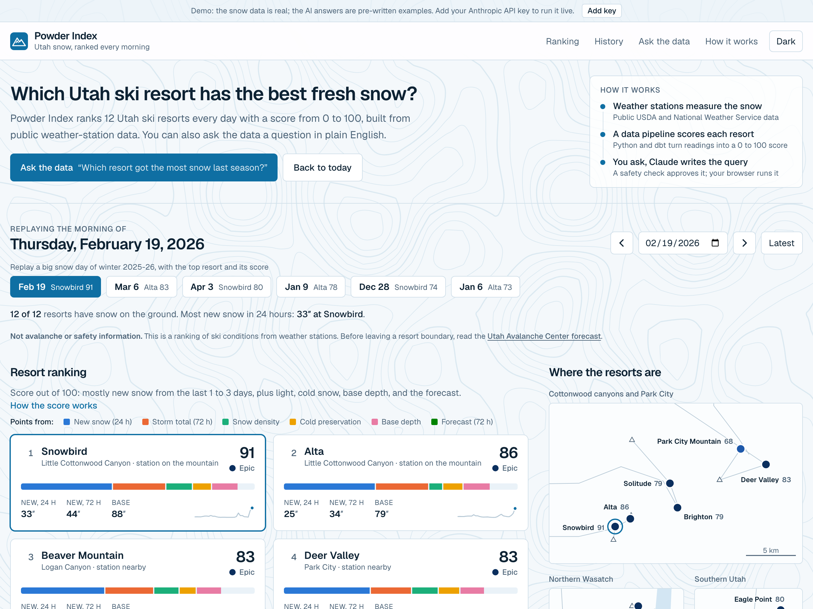

## Try it in 10 seconds

**[Open the live demo](https://powder-index.vercel.app)**: no key, no sign-up. It is October, so the page opens on an off-season morning. Click **Replay Feb 19: 33″ overnight** to jump to the best day of last winter, click a resort card to see how its score adds up, then scroll to **Ask the data** and pick a question. The SQL runs in your browser, in DuckDB-WASM, against the same Parquet files the pipeline publishes.

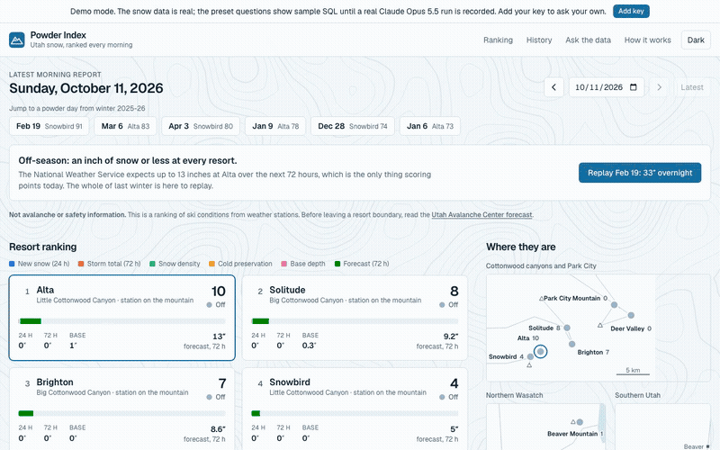

Demo data in this commit is hand-written sample output; `pnpm record` replaces it with real Claude Opus 5.5 runs.

What that means exactly:

- **Real:** every number on the dashboard. The snowpack readings are NRCS SNOTEL data and the forecast is from the National Weather Service, pulled on 11 October 2026 and committed as a snapshot. The marts are built from it by dbt, and a test rebuilds them and compares.
- **Real:** every row and chart under "Ask the data". A preset's SQL is executed when you click it; nothing is precomputed.
- **Hand-written for now:** the SQL, chart choice, and title behind the eight preset questions, and the two failed attempts in the sample retry trail. Each went through the real validator, and the errors shown are the ones that SQL really gets back. The app labels them "sample", never "recorded", and the labels follow each fixture's own flag.
- **Not yet run against the real API:** the live Claude path. It is complete and covered by tests with a scripted client, and the UI was driven through every live state against a mocked endpoint, but no API key existed when this was built.

## Why it's interesting

- **The model writes SQL, and nothing it writes is trusted.** A language model produces the query and a stranger's browser runs it, so a firewall built on sqlglot's syntax tree sits between them. It is an allowlist, not a blocklist: 63 permitted node types, 107 permitted functions, three permitted tables, and anything it has not been told about is refused without anyone having to think of it first. `ATTACH`, `COPY`, `PRAGMA`, `read_csv`, `FROM 'https://...'`, schema prefixes, recursive CTEs, and lambdas all fail for the same reason. The SQL that runs is regenerated from the tree, not copied from the model, so comments and odd quoting cannot smuggle anything through, and the output must validate to itself again or it is rejected. 170 tests cover it. The browser is a second lock: after the tables load, DuckDB-WASM has file and network access switched off and its configuration frozen.
- **New snow is estimated from two sensors that are each wrong in a different way.** A depth sensor reports whole inches, flickers, and reads low in a storm because the pack settles. A snow pillow is steady but cannot tell light snow from wet. So the depth gain is the estimate and the water gain fences it in: capped at what the water allows at 4% density (a depth spike with no water behind it cannot become a powder day), and floored at 20% density on a cold day (which recovers snow that settling hid). A one-inch rise counts only if the pillow moved too. Eight cases are pinned in a dbt unit test.
- **Code computes the facts; the model only writes the query.** Claude never sees a row and never states a number. It gets the schema, from dbt's own column docs, and returns SQL plus a chart spec through a strict tool. The firewall decides whether it may run, the browser computes the answer, and when DuckDB rejects a query its error message goes back to the model, at most twice. The page shows that trail instead of hiding it.

| | |
| --- | --- |
| 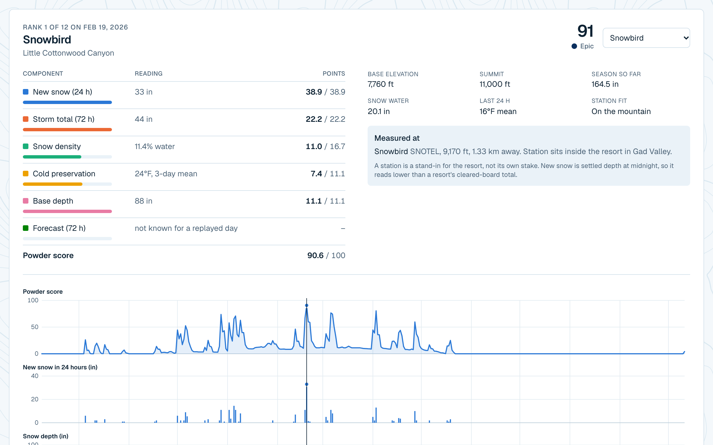 | 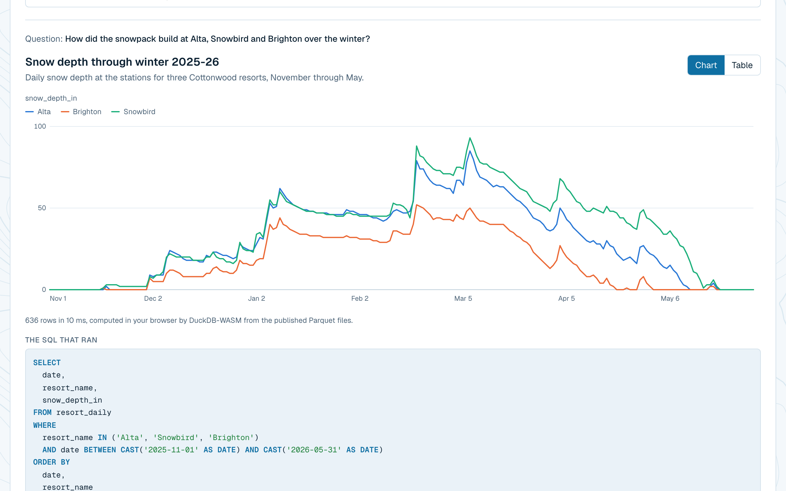 |
| How one score adds up, and the season it sits in | A question, its chart, and the SQL that ran |
| 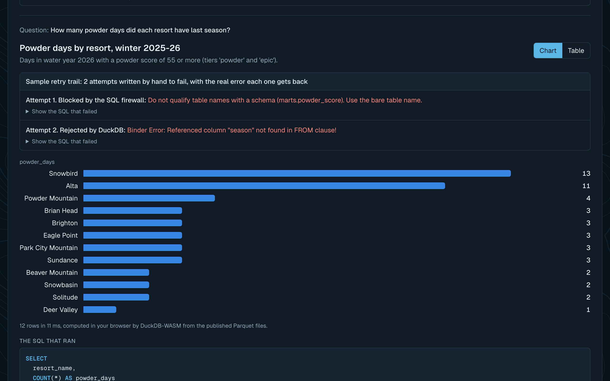 | 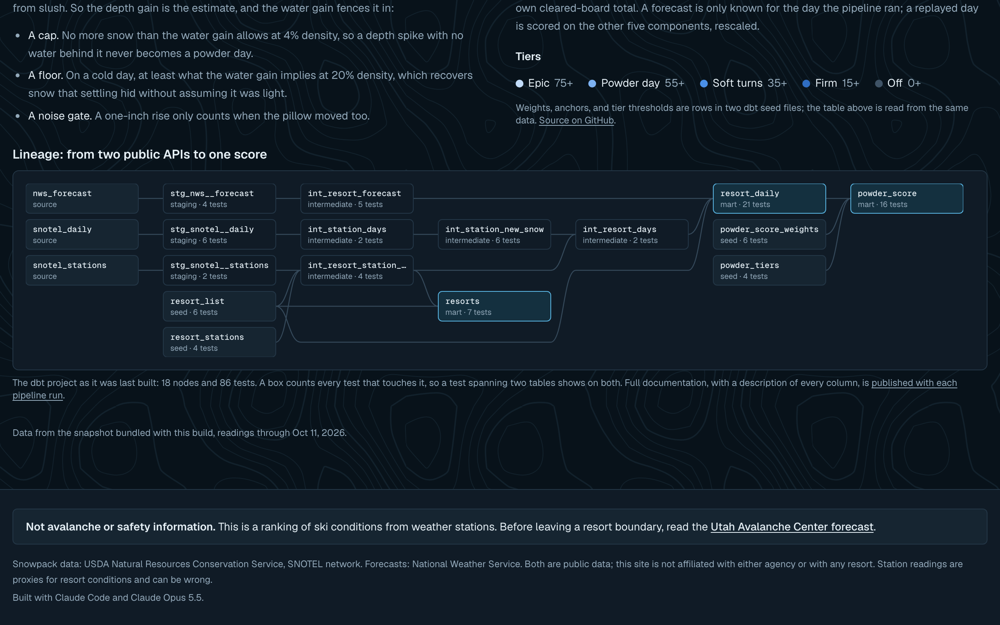 |
| The retry trail: one query blocked by the firewall, one rejected by DuckDB | Lineage drawn from dbt's manifest: 18 nodes, 86 tests |
| 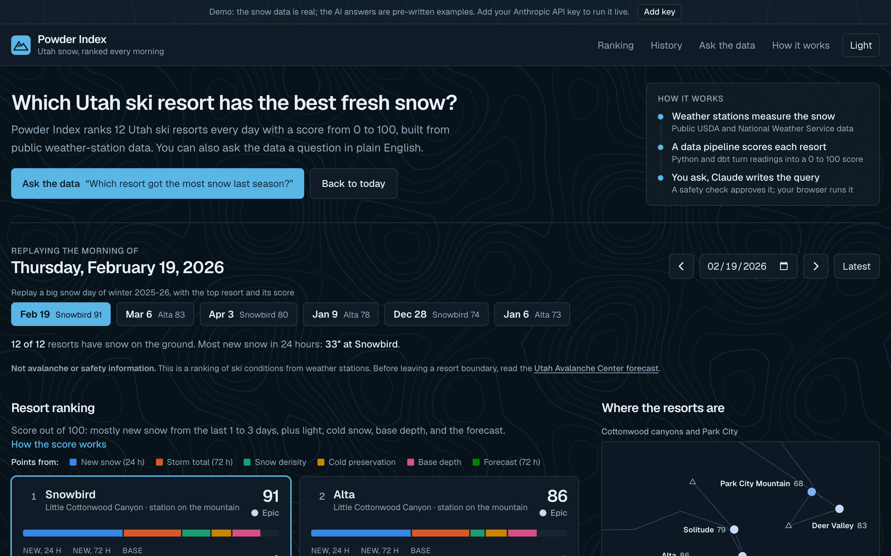 | 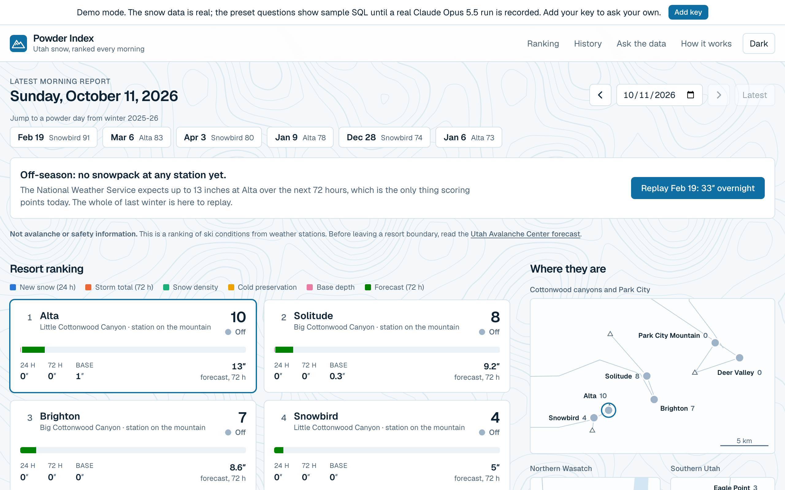 |
| Dark mode, with chart colors re-stepped for the dark surface | Off-season is a designed state: why every score is near zero, and one click to last winter |

<p>
  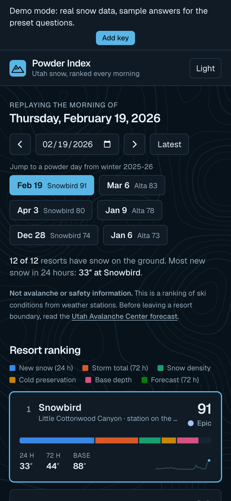
  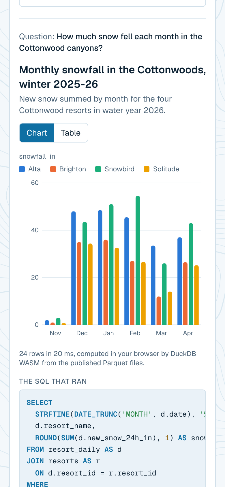
</p>

## Architecture

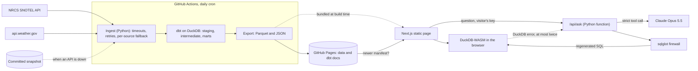

There is no server in the data path. The dashboard is a static page that reads files.

1. **Ingest** (`pipeline/powder/`). Daily snow depth, snow water equivalent, and temperature for 13 SNOTEL stations, plus the NWS gridpoint forecast for each resort. Every request has a timeout and retries with backoff. If an API stays down, that source alone falls back to the committed snapshot, and every row is stamped with when it was really fetched, so a stale fallback is visible to dbt's freshness check and to the site.
2. **Transform** (`pipeline/dbt/`). Sources, three staging views, five intermediate tables (a gap-free station calendar, the new-snow estimate, station-to-resort blending, rolling windows, the forecast clipped to 72 hours), and three marts: `resorts`, `resort_daily`, `powder_score`. 83 data tests and 3 unit tests.
3. **Publish** (`.github/workflows/pipeline.yml`). A daily cron runs ingest, source freshness, `dbt build`, the export, and `dbt docs generate`, then force-pushes one commit to the `gh-pages` branch, so `main` gets no data commits. If the SNOTEL pull failed, the run stops before publishing: the snapshot it fell back to is older than what is already live.
4. **Serve** (`app/`, `components/`, `lib/`). The page ships with the bundled snapshot, then fetches the published manifest and switches only if it is newer and passes the same schema. The selected date and resort live in the URL.
5. **Ask** (`pipeline/app/`, `api/ask.py`, `lib/ask/`). The only server-side code: one Python function that calls Claude and validates what comes back. Demo mode never calls it.

### The powder score

`score = 100 × Σ (weight × ramp) ÷ Σ (weights of the components known that day)`

| Component | Weight | Scores 0 at | Scores 1 at | Input |
| --- | ---: | --- | --- | --- |
| New snow, 24 h | 35% | 0 in | 12 in | Estimated new snow before the midnight reading |
| Storm total, 72 h | 20% | 0 in | 24 in | The same, summed over three days |
| Snow density | 15% | 18% water | 8% water | Water content of the 72-hour storm snow |
| Cold preservation | 10% | 36°F | 18°F | Mean air temperature over three days |
| Base depth | 10% | 0 in | 60 in | Snow on the ground at the station |
| Forecast, 72 h | 10% | 0 in | 12 in | NWS snowfall forecast |

Each ramp is linear between its two anchors and clamped to 0..1. Three details matter:

- **Lightness needs something to be light.** The density ramp is multiplied by `min(storm total ÷ 6 in, 1)`, so two inches of very dry snow does not score like a powder day. Cold counts only when there is snow on the ground.
- **A forecast exists only for the day the pipeline ran.** On a replayed day that component is unknown, so it is left out and the other five weights are rescaled. That is why new snow is worth 38.9 points in the hero screenshot and 35 on the latest day.
- **The breakdown always adds up.** The headline score is the sum of the rounded parts, not a separately rounded total.

Tiers: epic 75+, powder day 55+, soft turns 35+, firm 15+, off below that. Last winter produced 50 resort-days at "powder day" or better out of 4,380.

Weights and anchors are rows in one dbt seed (`pipeline/dbt/seeds/powder_score_weights.csv`). The mart, the dbt docs, the table on the site, and the model's prompt all read from it, and a singular dbt test recomputes every score longhand, with no shared macro, and compares.

### Resorts and stations

Alta, Snowbird, Brighton, Solitude, Park City Mountain, Deer Valley, Snowbasin, Powder Mountain, Sundance, Beaver Mountain, Eagle Point, and Brian Head, each mapped to one or two SNOTEL stations in `pipeline/dbt/seeds/resort_stations.csv` with a written reason. Two stations are blended by inverse distance. Each resort is labelled by how close its stations are: on the mountain (within 3 km, six resorts), nearby (within 8 km, five), or regional (Snowbasin, whose nearest station is 19 km away; the site labels it a regional signal only).

| Path | What it holds |
| --- | --- |
| `pipeline/powder/` | Ingest, export, and the CLI (`python -m powder run`) |
| `pipeline/dbt/` | Seeds, models, tests, and macros |
| `pipeline/data/snapshot/` | The committed raw pull that CI and the fallback build from |
| `pipeline/app/` | The Ask function: `sqlguard.py` (firewall), `ask.py` (model loop), `claude_client.py` |
| `api/ask.py` | Vercel entry point for the function |
| `public/data/` | Bundled marts: three Parquet files, `dashboard.json`, schema, lineage, manifest |
| `fixtures/` | The eight preset answers and the preset list `pnpm record` replays |
| `lib/duck/`, `lib/ask/`, `lib/chart/` | The browser engine, the ask loop, and chart logic |

## How it uses Claude Opus 5.5

| Feature | Why |
| --- | --- |
| Strict tool use: `run_query({ sql, title, chart, note })` and `cannot_answer({ reason })` | The answer has to be machine-checked, so its shape is guaranteed by the tool schema. Forced tool choice is not available on this model, so the code checks that a tool was called and nudges once if the model answered in text. |
| Effort `low` | Text-to-SQL over a documented schema is quick work, and a visitor is waiting. At list prices a question should cost a cent or two; that is an estimate from the prompt size, not a measurement, until a real run is recorded. |
| Self-correction loop | A validator rejection goes back as a tool error inside the request (up to three model calls). A DuckDB error comes back from the browser as a new request carrying the failed SQL and the message (at most twice). Both are shown to the visitor as a trail. |
| Prompt caching | The system prompt is the rules plus the schema from dbt's column docs, about 2,700 tokens and identical for every visitor. Today's date, the question, and failed attempts go in the user turn so they cannot spoil the cache. |
| Untrusted input | The question and any failed SQL arrive inside tags the system prompt declares to be data, and a closing tag inside the text is defused. |
| Refusals and declines | A model refusal reaches the page as a clear message. A question the tables cannot answer comes back through `cannot_answer` with a suggestion. |

What the model never does: see data, state a number, or have its SQL run unvalidated.

**Your key stays yours.** The app is bring-your-own-key. The key lives in your browser tab's memory (optionally `sessionStorage`), travels in an `x-anthropic-key` header to this app's own `/api/ask` function, and is used for that one request. The server never stores or logs it. Each live answer shows its token count and cost, summed across retries. Pressing Stop, asking something else, or leaving the page aborts the request, and the server stops before its next model call.

## Run locally

```bash
pnpm install
pnpm dev        # http://localhost:3140, demo mode: everything works with no key
pnpm dev:api    # optional, in a second terminal: the Python function, for live questions
```

`pnpm dev:api` and the pipeline need [uv](https://docs.astral.sh/uv/). To rebuild the data: `pnpm pipeline` (live pull, with the snapshot as fallback) or `pnpm pipeline:offline` (snapshot only, which is what CI does).

## Tests & quality

```bash
pnpm check                                   # lint, typecheck, 131 unit tests, production build
cd pipeline && uv run pytest -q              # 295 tests, including a full offline pipeline run
```

- **SQL firewall (170 tests):** allowed queries, every class of blocked statement and function, LIMIT injection and clamping, nested and CTE cases, injection hidden in comments and strings, and the fixed-point property. Every allowlisted function is also executed in DuckDB.
- **Pipeline:** fetch retries and backoff, each source's parser, the per-source fallback, and a test that runs ingest, `dbt build`, and the export from the snapshot and compares the result with the committed bundle.
- **dbt (86):** unique, not-null, accepted-range, and relationship tests; singular tests that recompute the score, check the new-snow bounds, and confirm there are no date gaps; unit tests for the estimator and gap handling.
- **Ask loop:** the Python loop with a scripted client (rejection and fix, three rejections, text answer, refusal, cancellation, tag break-out), and the browser loop with injected network and engine (retries, giving up, cost summed, cancellation).
- **Demo path:** every preset runs through the real loop in the same DuckDB-WASM engine the browser uses, and again in native DuckDB. Fixture tests read each fixture's own `placeholder` flag, so they hold after real runs are recorded.

CI runs the same checks plus a gitleaks secret scan on every push.

## Tradeoffs, limitations, next steps

- **A station is a proxy, not the resort's stake.** New snow here is settled depth at midnight at a station near the resort. It reads well below a resort's own total, which is measured on a cleared board through the storm: the Alta station's season estimate is 238 inches. Rankings between resorts are more trustworthy than the absolute numbers.
- **The weights are a judgment call.** They are one CSV file, documented and tested, but nobody has fitted them to skier ratings. A next step is to backtest them against resort-reported powder days.
- **The live Claude path and the two deployments are unproven.** No key existed, and nothing was pushed or deployed. The function has run locally under uvicorn but never on Vercel, and the pipeline workflow has never run on GitHub; each of its commands was run locally.
- **The firewall bounds what a query can touch, not how long it runs.** A legal three-way self-join is still a SELECT. The browser kills a query after 10 seconds, and it is the visitor's own tab that does the work.
- **Column names are not validated on purpose.** A wrong column is a correctness error that DuckDB reports, and that error is what the self-correction loop feeds back.
- **Presets are pinned to winter 2025-26.** The pipeline keeps the previous water year plus the current one, so in October 2027 those dates leave the window and the presets need re-recording.
- **DuckDB-WASM is about 7 MB compressed.** It loads on the first question, not on page load, so the dashboard itself stays light.
- **Forecast days use a fixed UTC-7 offset** to match SNOTEL's standard-time day, so in summer the forecast day starts an hour off local time.
- Until the pipeline workflow has published once, the browser console shows one failed request for the published manifest. The page falls back to the bundled data.
- Rate limiting is in memory per server instance: enough to blunt abuse of a demo, not a global quota.
- Next: record the fixtures with a key, fit the weights, add an elevation adjustment between station and summit, and extend past Utah.

---

Built with Claude Code and Claude Opus 5.5.
